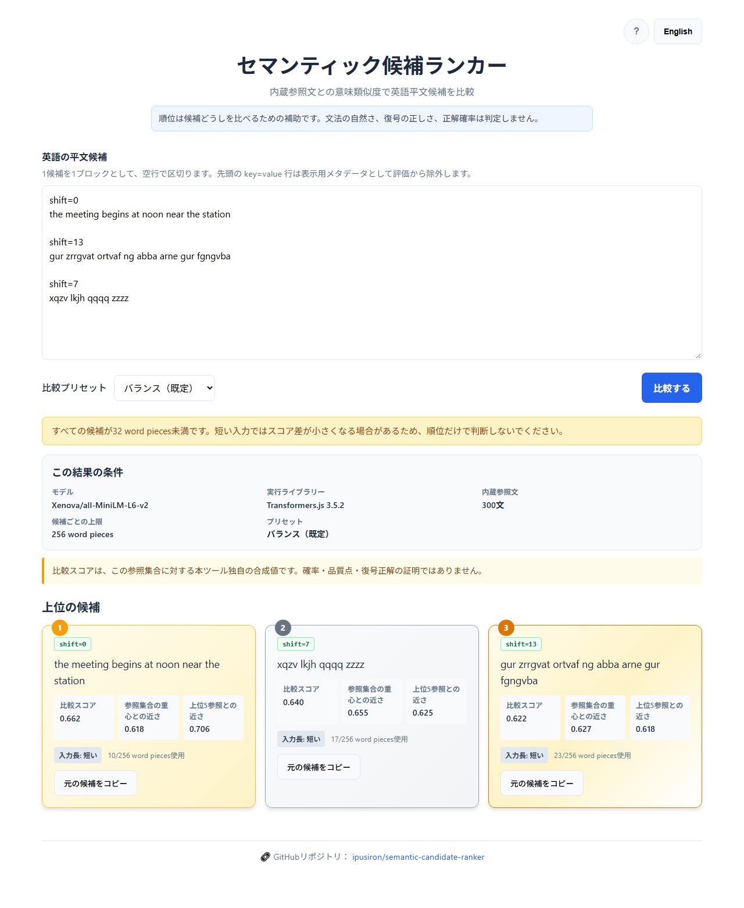
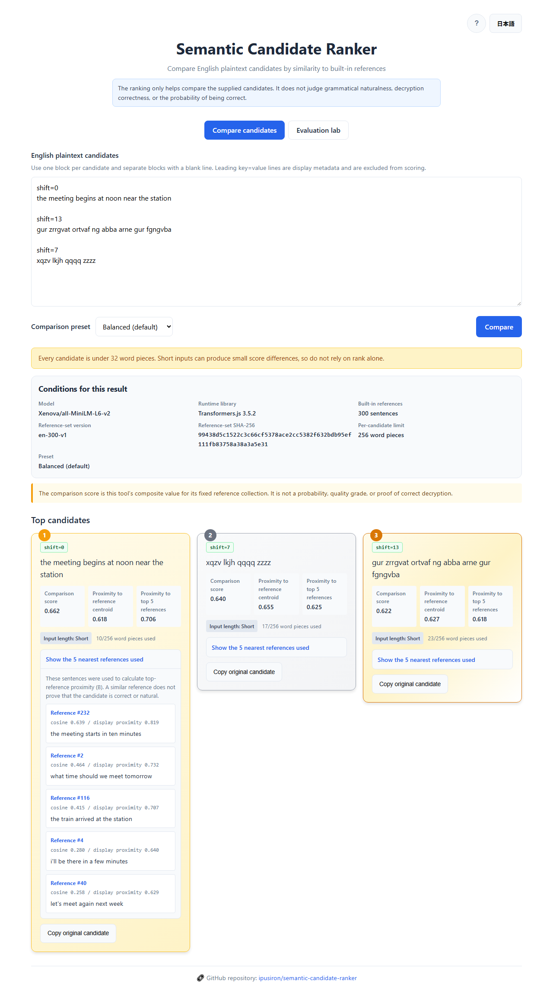

<!--
---
id: day110
slug: semantic-candidate-ranker

title: "Semantic Candidate Ranker"

subtitle_ja: "平文候補の意味類似度比較ツール"
subtitle_en: "Semantic Similarity Comparison for Plaintext Candidates"

description_ja: "複数の英語平文候補を、内蔵参照文との意味類似度で比較・順位付けするブラウザーベースの学習ツール"
description_en: "A browser-based learning tool that compares and ranks English plaintext candidates by semantic similarity to built-in references"

category_ja:
  - 暗号解析
  - 自然言語処理
category_en:
  - Cryptanalysis
  - NLP

difficulty: 4

tags:
  - embedding
  - transformers
  - semantic-similarity
  - cipher
  - browser

repo_url: "https://github.com/ipusiron/semantic-candidate-ranker"
demo_url: "https://ipusiron.github.io/semantic-candidate-ranker/"

hub: true
---
-->

# Semantic Candidate Ranker - 平文候補の意味類似度比較ツール


[](https://ipusiron.github.io/semantic-candidate-ranker/)

**Day110 - 生成AIで作るセキュリティツール200**

Semantic Candidate Rankerは、複数の英語平文候補をベクトル化し、内蔵した一般英文300文との意味類似度で比較・順位付けする学習ツールです。暗号を解読するのではなく、別のツールや手作業で得た候補を見直す手掛かりを示します。

比較スコアは本ツールの参照集合に対する独自の合成値です。文法の自然さ、文章の品質、復号の正しさ、正解確率を判定する値ではありません。

[English README](README.en.md)

---

## 🌐 デモページ

👉 **[https://ipusiron.github.io/semantic-candidate-ranker/](https://ipusiron.github.io/semantic-candidate-ranker/)**

ブラウザーで直接試せます。キャッシュがない場合は、Transformers.jsと機械学習モデルを外部配信元から取得するため、インターネット接続が必要です。

---

## 📸 スクリーンショット

> 
>
> *日本語表示。参照集合の版・指紋と、Bへ使った近傍参照文5件を展開しています。*

> 
>
> *英語表示。言語を切り替えても入力と計算済み結果を保持し、同じ近傍参照を確認できます。*

---

## ✨ できること／できないこと

### できること

- 最大200件の英語平文候補を、内蔵参照文との意味類似度で順位付けする
- 合成値だけでなく、参照集合の重心との近さと、近い参照文群との近さを分けて確認する
- 候補ごとに、上位k参照の計算へ使った参照文、集合内番号、個別cosineを展開して確認する
- 参照集合の版とSHA-256指紋を結果条件として確認する
- `shift=13`や`branch=B12`などのメタデータを表示・コピーしつつ、比較対象から除外する
- 実際のトークナイザーで入力長を数え、256 word piecesを超えた候補を知らせる
- 日本語と英語の画面を切り替える

### できないこと

- 暗号の解読、鍵の探索、正解候補の自動決定
- 文法検査、スペル検査、文章品質の採点
- 候補が事実か、意図した平文か、安全かを証明すること
- スコアを確率や校正済み評価値として扱うこと

---

## 📖 使い方

1. 別の解読ツールや手作業で英語の平文候補を用意します。
2. 1候補を1ブロックとし、空行で区切って入力します。
3. 比較プリセットを選び、「比較する」を押します。
4. 順位だけでなく、2つの類似度成分、入力長、切り詰め表示を確認します。
5. 「計算に使った近傍参照文」を開き、Bへ寄与した参照文と個別cosineを確認します。
6. 上位候補を人が読み、暗号方式・鍵・文脈と照合します。

入力やプリセットを変更すると、古い結果は非表示になります。日英を切り替えた場合は、計算し直さずに同じ結果を選択中の言語で再表示します。

---

## 📝 入力形式

### 候補ブロック

- 1候補を1ブロックとして入力する
- ブロックを1行以上の空行で区切る
- ブロック内の改行は比較前に空白へ正規化する
- 空ブロックと、メタデータしかないブロックは無視する

```text
this is a secret message

another candidate here
```

### メタデータ

ブロック先頭に連続する`key=value`行は、表示用メタデータとして認識します。キーは英数字またはアンダースコアです。最初の通常行が現れた後の`key=value`は平文の一部として扱います。

```text
shift=0
the meeting begins at noon near the station

shift=13
gur zrrgvat ortvaf ng abba arne gur fgngvba
```

- メタデータは埋め込みとスコア計算から除外する
- 同じキーが複数回続く場合は最初の値を採用する
- コピーボタンはメタデータを含む元のブロックをコピーする
- メタデータ値だけを変えても、同じ平文ならスコアは変わらない

### 正規化

比較対象の平文は、小文字化、改行から空白への変換、連続空白の圧縮、前後空白の除去を行います。アポストロフィは保持します。

---

## 🌐 対応言語

- 画面: 日本語／英語
- 平文候補: 英語のみ
- 内蔵参照文: 英語のみ

画面言語は計算内容に影響しません。日本語など、モデルと参照集合が想定していない入力の結果は解釈できません。

---

## 🔬 比較スコアの仕組み

モデルは各候補と300件の参照文を384次元ベクトルへ変換します。候補ごとに次の2成分を計算し、表示用に0～1へ変換します。

### A）参照集合の重心との近さ

全参照文ベクトルの平均をL2正規化した重心と、候補ベクトルとのコサイン類似度です。これは参照集合全体の中心への近さであり、「英語としての自然さ」そのものではありません。

### B）上位k参照との近さ

候補と各参照文のコサイン類似度を求め、最も近いk文の平均を取ります。参照文に似た表現が含まれるほど上がりやすく、参照集合の内容に依存します。

各候補の展開欄には、この平均へ実際に使ったk文を近い順で表示します。集合内番号、元のcosine、0～1へ変換した表示上の近さを確認できます。同じcosineの場合は参照集合内の順序を保ちます。近い文が見つかることは、その候補が正しい平文または自然な英文であることの証明ではありません。

### 合成

```text
A = (cos(candidate, centroid) + 1) / 2
B = (average(top-k cosine similarities) + 1) / 2
comparison_score = wA × A + wB × B
```

合成値は候補を並べるための便宜的な値です。しきい値による「優秀」「不良」などの品質判定は行いません。

### プリセット

| プリセット | wA | wB | k | 変わる点 |
| --- | ---: | ---: | ---: | --- |
| バランス（既定） | 0.5 | 0.5 | 5 | 2成分を同じ重みで合成 |
| 参照重心寄り | 0.7 | 0.3 | 5 | Aを多めに反映 |
| 近い参照例寄り | 0.3 | 0.7 | 5 | Bを多めに反映 |
| 上位3参照 | 0.5 | 0.5 | 3 | Bを最も近い3文で計算 |
| 上位7参照 | 0.5 | 0.5 | 7 | Bを最も近い7文で計算 |

kを小さくしても「厳格」、大きくしても「寛容」になるとは限りません。参照文との類似度分布が変わるため、順位の感度を比べる設定として使います。

---

## ⚙️ モデル・入力長・再現条件

- モデル: `Xenova/all-MiniLM-L6-v2`
- 実行ライブラリー: Transformers.js 3.5.2
- 出力: 384次元、mean pooling、L2正規化
- 参照集合: リポジトリー内の固定英文300文
- 参照集合版: `en-300-v1`
- 参照集合SHA-256: `99438d5c1522c3c66cf5378ace2cc5382f632bdb95ef111fb83758a38a3a5e31`
- 入力上限: 候補ごとに256 word pieces（特殊トークンを含む）

上流の[all-MiniLM-L6-v2モデルカード](https://huggingface.co/sentence-transformers/all-MiniLM-L6-v2)は、このモデルを文・短い段落のエンコーダーとし、256 word piecesを超える入力は既定で切り詰めると説明しています。本ツールも実行時のトークナイザー上限を256へ固定します。

参照集合の指紋は、英語300文をソース順のJSON配列にし、そのUTF-8バイト列へSHA-256を適用した値です。文または順序が変われば別の指紋になりますが、第三者による真正性の証明や署名ではありません。

画面にはモデル、ライブラリー版、参照文数、参照集合版・指紋、上限、プリセットを結果条件として表示します。入力長は「信頼度」ではなく、短い／中程度／長い／上限超過という記述的な区分です。

---

## ⚠️ 限界

- 参照集合は英語全体を代表する評価データではなく、手作りの固定例である
- スコアしきい値を正解付きデータで校正していない
- 自然な英文と無意味な文字列のスコア差が小さい場合がある
- 短い入力では候補間の差が小さくなる場合がある
- 256 word piecesを超えた部分は比較へ使わない
- 専門用語、固有名詞、参照集合にない文体は不利になる場合がある
- 近傍参照文はBの内訳であり、候補の正しさ・自然さ・出典を示す証拠ではない
- 同じモデル・参照集合・プリセットでも、候補集合が変われば順位の読み方も変わる

順位は仮説を絞るための補助です。暗号方式や鍵の整合性、文脈、既知平文、別の統計指標と併用してください。

---

## 🌐 ネットワークとプライバシー

- アプリのコードは入力候補を外部APIへ送信せず、埋め込みと比較をブラウザー内で実行する
- キャッシュがない場合、Transformers.jsをjsDelivrから、モデル関連ファイルをHugging Faceから取得する
- ブラウザーは取得物をキャッシュできますが、削除・容量制限・プライベートモードなどがあるため、次回のオフライン利用を保証しない
- 画面の「ブラウザーはオフライン」は`navigator.onLine`の状態であり、モデルが利用可能かを保証しない
- テレメトリーは実装していない

機密性の高い候補を扱う場合は、外部ファイルの取得が済んでいること、開発者ツールのNetworkで入力を含む送信がないこと、利用端末とブラウザーキャッシュの管理状態を自分で確認してください。

---

## 🔒 セキュリティ

- ユーザー入力は`textContent`でDOMへ挿入し、`innerHTML`へ代入しない
- CSPでスクリプト、接続先、ワーカーを必要な配信元へ限定する
- 外部ライブラリーは3.5.2へ固定する。動的`import()`にはSRIを付けられないため、jsDelivrを信頼境界に含む
- 外部リンクを新しいタブで開く箇所には`noopener noreferrer`を指定する
- GitHub Pagesでは任意のHTTPセキュリティーヘッダーを設定できないため、CSPメタとReferrer Policyメタで可能な範囲を制御する

---

## 🎯 ユースケース

### このツールならではの使い方

- **シーザー暗号の総当たり候補を絞る**: `shift=N`を残したまま候補を貼り、意味参照への近さで読む順番を決める。添付画面では3候補の比較スコアが0.662、0.640、0.622に分かれています。
- **換字式暗号の分岐を比べる**: `branch=B12`や`mapping=...`を表示したまま、平文部分だけを比較する。コピー時には追跡情報を失いません。
- **別の復号器どうしの出力を比較する**: 同じ暗号文から得た候補を1ブロックずつ並べ、重心寄り／近い参照例寄りで順位が変わるかを確認します。
- **参照集合への依存を学ぶ**: 上位3参照と上位7参照を切り替え、展開欄でBへ使われた文と個別cosineを見ながら、kによる合成値の変化を観察します。
- **長文の切り詰めを確認する**: 256 word piecesを超える候補を入れ、元の長さと実際に使用した長さを比較します。

### 一般的な用途

- 古典暗号解読の授業や演習
- 埋め込み、コサイン類似度、参照集合バイアスの学習
- 人間が精査する候補の優先順位付け
- メタデータを除外した場合と、別の統計手法の結果との比較

---

## 📁 ディレクトリー構造

```text
semantic-candidate-ranker/
├── .github/workflows/test.yml # Node.jsの自動テスト
├── assets/
│   ├── screenshot.png         # 日本語画面
│   └── screenshot-en.png      # 英語画面
├── docs/
│   ├── ALGORITHM.md           # スコア計算の詳細
│   ├── EMBEDDING.md           # 埋め込みモデルの説明
│   ├── REFERENCE_DESIGN.md    # 参照文集合の設計
│   ├── SPEC.md                # 機能仕様
│   └── UI_SPEC.md             # 画面仕様
├── js/
│   ├── app.js                 # 5段階処理の制御
│   ├── embedder.js            # モデル取得・埋め込み・入力長検査
│   ├── i18n.js                # 日英メッセージ
│   ├── normalizer.js          # 入力解析・正規化
│   ├── reference-sentences.js # 固定参照文300文
│   ├── scorer.js              # DOM非依存の比較計算
│   └── ui.js                  # 安全なDOM描画
├── scripts/browser-check.mjs  # Edgeによる手動ブラウザー検証
├── style/                     # モバイルファーストCSS
├── test/                      # 依存なしの回帰テスト
├── index.html                 # GitHub Pagesの入口
├── package.json               # テストコマンド
├── README.md                  # 日本語版
├── README.en.md               # 英語版
├── CLAUDE.md                  # 開発時の指針
└── LICENSE                    # MIT License
```

---

## 💻 動作環境とテスト

ES Modules、WebAssembly、IndexedDB、動的`import()`に対応する現行のデスクトップ／モバイルブラウザーを想定しています。

依存パッケージのインストールなしで、Node.js 22以上の標準テストを実行できます。

```shell
npm test
```

---

## 📄 ライセンス

- ソースコードのライセンスは`LICENSE`を参照してください。
- [Transformers.js](https://huggingface.co/docs/transformers.js/)と[all-MiniLM-L6-v2](https://huggingface.co/sentence-transformers/all-MiniLM-L6-v2)を利用しており、それぞれのライセンスに従います。

---

## 🛠️ このツールについて

本ツールは、「生成AIで作るセキュリティツール200」プロジェクトの一環として開発されました。
このプロジェクトでは、AIの支援を活用しながら、セキュリティに関連するさまざまなツールを100日間にわたり制作・公開していく取り組みを行っています。

プロジェクトの詳細や他のツールについては、以下のページをご覧ください。

🔗 [https://akademeia.info/?page_id=44607](https://akademeia.info/?page_id=44607)
